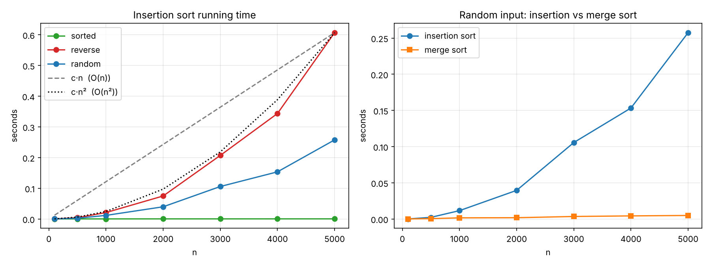

# 1. Empirical Analysis of Insertion Sort

Implement insertion sort, count its comparisons and shifts, time it on sorted, reverse-sorted and
random input for n = 100 … 5,000, and compare the curves with O(n) and O(n²). Merge sort is the baseline.

## Run

```bash
python -m unittest          # 4 tests
python experiment.py        # prints a table, writes results/results.csv and results/plot.png
python experiment.py --sizes 100 500 1000 --repeats 2   # quicker run
```

## Files

| File | Purpose |
|------|---------|
| `insertion_sort.py` | `insertion_sort`, `insertion_sort_counted` (returns comparisons, shifts), `merge_sort` |
| `experiment.py` | Timing experiment, CSV, plot, doubling-ratio report |
| `test_insertion_sort.py` | Correctness and the counts from the lecture (`[4,3,2,1]` → 6 comparisons, 6 shifts; `[1,2,3,4]` → 3, 0) |
| `results/` | `results.csv` and `plot.png` from the run below |

## Results (n = 5,000)

| Input | Insertion sort | Merge sort | Comparisons | Shifts |
|-------|---------------:|-----------:|------------:|-------:|
| sorted | 0.25 ms | 3.4 ms | 4,999 | 0 |
| random | 258 ms | 4.9 ms | 6,285,811 | 6,280,818 |
| reverse | 607 ms | 4.1 ms | 12,497,500 | 12,497,500 |



## Findings

* **Best case, Ω(n).** On sorted input every element needs one comparison and no shift: exactly n − 1 = 4,999 comparisons.
* **Worst case, O(n²).** On reversed input the counts are exactly n(n−1)/2 = 12,497,500. Doubling n multiplies the time by about 4 (measured ×3.6 to ×4.9).
* **Average case.** On random input the counts are close to n²/4 (6.29 M vs 6.25 M), so about half the worst case, and still quadratic.
* **Space.** Sorting is in place, only O(1) extra memory, so insertion sort is time-costly but space-cheap.
* **Versus merge sort.** At n = 5,000 merge sort is 50× to 150× faster on random/reversed data, but insertion sort wins on already (nearly) sorted data. That is why hybrid sorts switch to insertion sort for small or almost-sorted pieces (see project 2).
