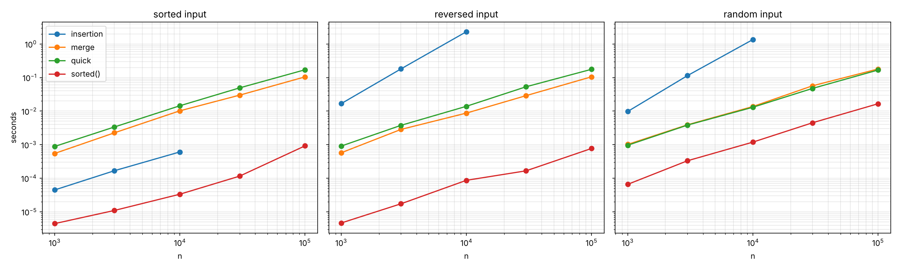

# 2. Sorting Benchmark Lab

Compare **insertion sort, merge sort, quicksort and Python's built-in `sorted()`** on sorted, reversed and
random data, for n = 10³ … 10⁵.

## Run

```bash
python -m unittest                  # correctness tests
python benchmark.py                 # writes results/results.csv and results/plot.png
python benchmark.py --sizes 1000 10000 --repeats 1      # quick run
```

Insertion sort is skipped above `--insertion-limit` (default 10,000) because O(n²) would take minutes.

## Files

| File | Purpose |
|------|---------|
| `algorithms.py` | The four sorts. Quicksort uses a random pivot and 3-way partitioning, so sorted input and many duplicates are not a problem |
| `benchmark.py` | Generates inputs, checks every result against `sorted()`, takes the best of 3 runs, writes CSV + plot |
| `test_algorithms.py` | Edge cases, duplicates, 20,000 sorted items, input not modified |

## Results

Best of 3 runs, milliseconds:

| n | input | insertion | merge | quick | `sorted()` |
|--:|-------|----------:|------:|------:|-----------:|
| 10,000 | random | 1,354 | 13.7 | 13.0 | 1.2 |
| 10,000 | reversed | 2,318 | 8.7 | 13.9 | 0.09 |
| 10,000 | sorted | 0.6 | 10.2 | 14.4 | 0.03 |
| 100,000 | random | skipped | 180 | 168 | 16.6 |
| 100,000 | reversed | skipped | 105 | 176 | 0.8 |
| 100,000 | sorted | skipped | 105 | 170 | 0.9 |



## Findings

* Insertion sort is the clear loser beyond a few thousand items on random/reversed data (about 100× slower than merge sort at n = 10,000), but it is the fastest *pure-Python* sort on sorted input (O(n)).
* Merge sort and quicksort both follow n log n and have similar times on random data; merge sort is more predictable, quicksort does less copying but depends on a good pivot.
* `sorted()` (Timsort, implemented in C) is far faster than all the pure-Python versions, and runs in O(n) on sorted and reversed input because it detects existing runs.
* Part of the gap to `sorted()` is the language (C vs interpreted Python), not only the algorithm. Compare the *growth* of each curve, not just the absolute values.
