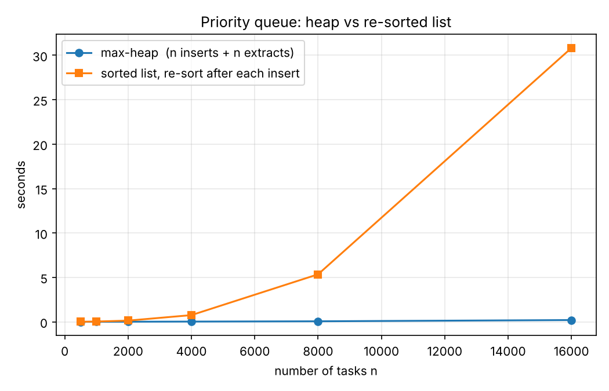

# 3. Task Scheduler (max-heap priority queue)

Simulates an OS scheduler that always runs the most urgent task next, using a **max-heap written from scratch**
(no `heapq`). Higher priority number = more urgent; ties go to the task that arrived first.

## Run

```bash
python -m unittest        # 7 tests (heap property, ordering, ties, INCREASE-KEY, aging)
python demo.py            # lecture example, 20 random tasks, starvation vs aging
python benchmark.py       # heap vs re-sorted list, writes results/results.csv and results/plot.png
```

## Milestones from the lecture

| # | Milestone | Where |
|---|-----------|-------|
| 1 | `Task` with name, priority, arrival time | `scheduler.py` |
| 2 | `INSERT` and `EXTRACT-MAX` on an array-based max-heap | `max_heap.py` |
| 3 | Feed 20 random tasks and print the run order | `demo.py` |
| 4 | Compare with a sorted list that re-sorts after every insert | `benchmark.py` |
| ★ | Extension: aging with `INCREASE-KEY` | `Scheduler(aging=k)` |

Lecture example: tasks A(3), B(9), C(5), D(7) run in the order **B, D, C, A**.

## Complexity

| Operation | Heap | Sorted list (re-sort per insert) |
|-----------|------|----------------------------------|
| INSERT | O(log n) | O(n) (Timsort on an almost sorted list) |
| EXTRACT-MAX | O(log n) | O(1) pop, but the sort already paid for it |
| INCREASE-KEY | O(log n) (position table, no search) | O(n) |
| n inserts + n extracts | O(n log n) | O(n²) |

## Aging (starvation demo)

`LOW` (priority 1) arrives first, then a new priority-5 task arrives every tick for 12 ticks.

```
no aging              : LOW starts at tick 12   (after all 12 urgent tasks)
aging every 2 ticks   : LOW starts at tick 8
```

With aging, a task that waits gains +1 priority every `k` ticks through `INCREASE-KEY`, so it eventually overtakes newer tasks.

## Benchmark: n inserts + n extracts

| n | heap | sorted list | speed-up |
|--:|-----:|------------:|---------:|
| 1,000 | 5 ms | 35 ms | ×6 |
| 4,000 | 28 ms | 755 ms | ×27 |
| 16,000 | 199 ms | 30.8 s | ×155 |



The heap grows like n log n while the re-sorted list grows quadratically, and the gap widens with n.
