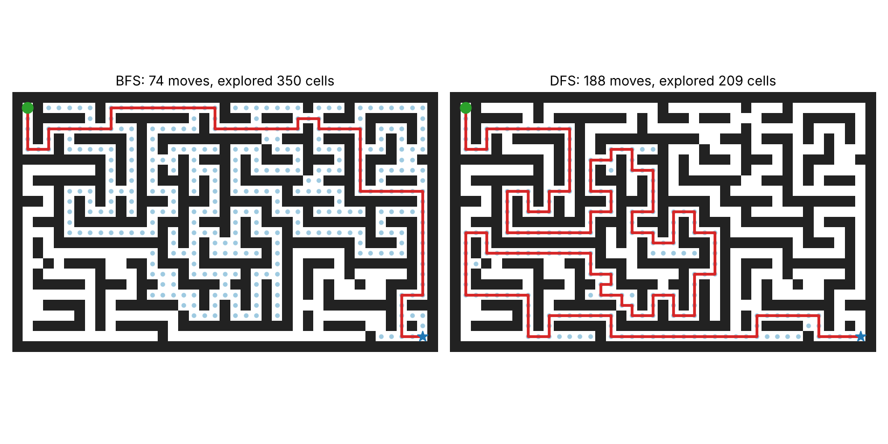
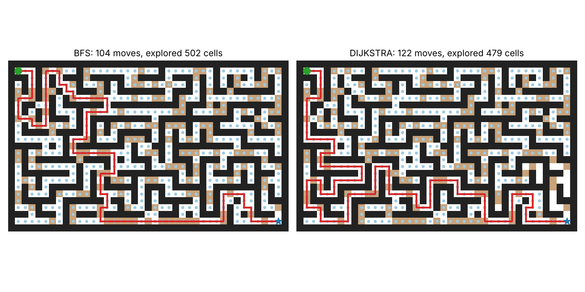

# 4. Maze Solver (BFS, DFS and Dijkstra)

Solves a grid maze three ways. The grid is an **implicit graph**: cells are vertices and open neighbours
(up, down, left, right) are edges. Each search stores a **parent** for every cell and rebuilds the path at the end.

| Solver | Data structure | Result |
|--------|----------------|--------|
| BFS | queue | shortest path (fewest moves) |
| DFS | stack | *a* path, often much longer |
| Dijkstra | min-heap | cheapest path when `m` (mud) cells cost 5 |

## Run

```bash
python -m unittest                                   # 7 tests
python maze_solver.py mazes/small.txt                # the 3×4 maze from the lecture
python maze_solver.py --random 25 41 --seed 1 --no-ascii --png results/bfs_vs_dfs.png
python maze_solver.py --random 25 41 --seed 36 --mud 0.3 --algos bfs dijkstra --no-ascii --png results/dijkstra_mud.png
```

Maze format: `#` wall, `.` open, `S` start, `E` end, `m` mud. You can write your own maze in a text file.

## Lecture example

```
S..#        BFS: 5 moves (shortest)       DFS: also 5 moves here
##..        S**#                           S**#
...E        ##*.                           ##**
            ..*E                           ...E
```

## Bigger random maze (25 × 41, seed 1)



| Solver | Moves | Cells explored |
|--------|------:|---------------:|
| BFS | **74** | 350 |
| DFS | 188 | 209 |

BFS always finds the shortest path but explores outward in every direction; DFS dives deep, so it can
explore fewer cells yet return a path more than twice as long.

## Extension: weighted cells (mud, seed 36)



| Solver | Moves | Total cost |
|--------|------:|-----------:|
| BFS (fewest moves) | 104 | 276 |
| Dijkstra (cheapest) | 122 | **238** |

With weights, fewest moves is no longer cheapest: Dijkstra takes 18 extra moves to walk around mud and saves 38 cost.

## Files

`maze_solver.py` (parser, generator, three solvers, ASCII + PNG output) · `test_maze_solver.py` · `mazes/small.txt` · `results/`
